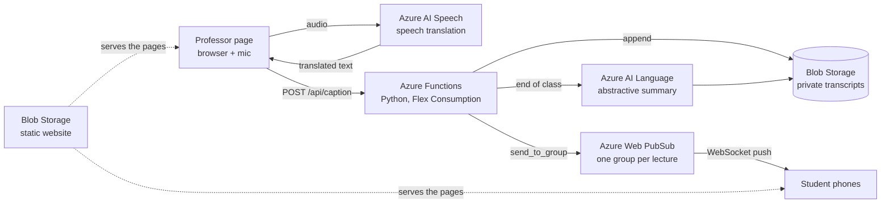

# Fhemni — live lecture captions, translated for every student

> *Fhemni* means "understand me" in Moroccan Darija.

The professor speaks French into a laptop. Each student scans a QR code and reads the lecture **live on their phone, in their own language** (English, Arabic, Spanish, German, Chinese). When the class ends, every student gets an **AI-written summary** of the lecture in their language.


*Live demo (30 s): the professor dashboard shows each French sentence forming in real time, then finalized with its English, Arabic and Spanish translations, which are pushed to students' phones at the same moment.*

Built entirely on **Microsoft Azure** with serverless and managed AI services. No virtual machines, and close to €0 when idle.

## Architecture



| Azure service | Role |
|---|---|
| Blob Storage (static website) | Hosts the 3 web pages over HTTPS |
| Blob Storage (private container) | Transcript of each lecture (append blob, JSON Lines) and summaries |
| Azure Functions (Python v2) | 5 HTTP endpoints, the only component that holds secrets |
| Azure AI Speech | Real-time French speech recognition + translation |
| Azure Web PubSub | Pushes each sentence to all phones over WebSocket (pub/sub) |
| Azure AI Language | Abstractive summary of the transcript, per language |

## How it works

1. The student page calls `GET /api/negotiate` and receives a signed Web PubSub URL limited to its lecture group (receive-only).
2. The professor page gets a 10-minute AI Speech token from `GET /api/speech-token` (refreshed every 9 min) and streams the microphone to AI Speech.
3. In-progress sentences (`partial`) are pushed about once per second so students see text immediately. Final sentences are pushed and then appended to the transcript.
4. `POST /api/end-session` reads the transcript, asks AI Language for a 5-sentence summary in each language, stores it, and notifies the phones.

## Security choices

- **No keys in the browser.** Pages only ever receive short-lived tokens. All keys live in Function App settings.
- **Only the professor can broadcast.** Write endpoints require a professor code checked server-side (`401` otherwise).
- **Input validation.** Lecture codes and language codes are validated with strict regexes.
- **Least privilege.** Students can't publish, the transcript container is private, CORS only allows the site, and access to the resource group goes through Azure RBAC.
- **Resilience.** The pages reconnect automatically when the AI Speech or WebSocket connection drops.

## Project layout

```
api/            Azure Functions backend (function_app.py, requirements.txt, host.json)
web/            Static site: index, prof (dashboard), etudiant (student view), style
deploy.sh       Idempotent Azure CLI script that creates and deploys everything
```

## Deploy

Requirements: an Azure subscription and Azure Cloud Shell (Bash) or the Azure CLI.

```bash
./deploy.sh      # creates rg-fhemni in France Central, all services, then deploys the code
```

The script generates a professor code and stores it in `.fhemni.env`, which is git-ignored. To remove everything:

```bash
az group delete -n rg-fhemni --yes
```

## Team

Cloud Computing project, 4th year, Université Internationale de Rabat (UIR), supervised by Pr. Ouassim Karrakchou.

- Houssam Jabar
- Anas Jarniji
- Ilyas Ibrahim
